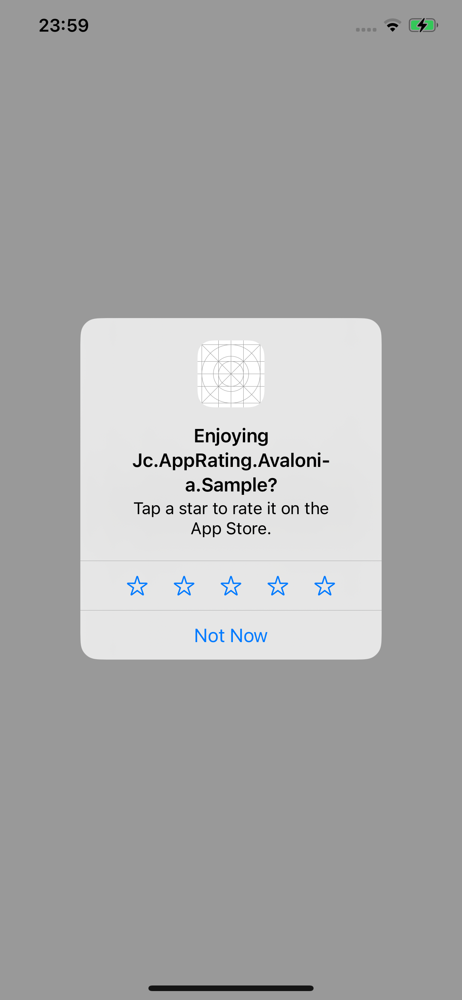

# Jc.AppRating.Avalonia

Library to bring App store app ratings to Avalonia mobile projects.

---

## Table of Contents

- [Introduction](#introduction)
- [Requirements](#requirements)
- [Usage](#usage)
  - [Android registration](#android-registration)
  - [iOS registration](#ios-registration)
- [iOS](#ios)
- [Android](#android)

## Introduction

Jc.AppRating.Avalonia is a library to bring app store rating services to Avalonia Android and iOS projects.

This includes the in-app rating functionality for Android and iOS as well as the ability to open the app store page for the app to review.

## Requirements

This version requires .NET 10 and Avalonia 12.1.4 or later within the 12.x series,
plus the Android and/or iOS .NET workloads. .NET 9 and Avalonia 11 are no longer
supported by this version; use an earlier package version for those targets.
The public rating API and package IDs are unchanged.

Android development requires the Android SDK supported by the installed .NET 10
workload. iOS development requires macOS and the Xcode version required by the
installed iOS workload. Android now requires API 23 (Android 6.0) because the
upgraded AndroidX dependencies no longer support API 21. iOS now requires iOS 15.0,
the minimum supported by the current .NET 10 iOS workload.

CI uses the macOS 26 runner with Xcode 26.6 and workload set `10.0.401` to keep
those toolchain versions compatible. Newer workloads may require a newer Xcode.

## Usage

To use Jc.AppRating.Avalonia you must add the `Jc.AppRating.Avalonia` package to your cross-platform project.

```
dotnet add package Jc.AppRating.Avalonia
```

Followed by adding the Android/iOS `Jc.AppRating.Avalonia.xxx` package to the platform specific project(s).

```
dotnet add package Jc.AppRating.Avalonia.Android
dotnet add package Jc.AppRating.Avalonia.iOS
```

Register AppRating in the platform startup code.

### Android registration

Avalonia 12 configures the app in an `AvaloniaAndroidApplication<App>` subclass:

```c#
using Android.App;
using Android.Runtime;
using Avalonia;
using Avalonia.Android;
using Jc.AppRating.Avalonia.Android;

[Application]
public class AndroidApp : AvaloniaAndroidApplication<App>
{
    public AndroidApp(IntPtr javaReference, JniHandleOwnership transfer)
        : base(javaReference, transfer) { }

    protected override AppBuilder CustomizeAppBuilder(AppBuilder builder)
        => base.CustomizeAppBuilder(builder).UseAppRating();
}
```

The main activity inherits from the non-generic `AvaloniaMainActivity`. Initialize
MAUI Essentials in its `OnCreate` override so review requests can find the current activity:

```c#
protected override void OnCreate(Android.OS.Bundle? savedInstanceState)
{
    base.OnCreate(savedInstanceState);
    Microsoft.Maui.ApplicationModel.Platform.Init(this, savedInstanceState);
}
```

In the shared application's `OnFrameworkInitializationCompleted`, handle
`IActivityApplicationLifetime` before `ISingleViewApplicationLifetime` and assign
`MainViewFactory` to create a new view and view model per activity. See the sample
for a complete startup implementation.

### iOS registration

Register in the `AvaloniaAppDelegate<App>` subclass in `AppDelegate.cs`:

```c#
using Jc.AppRating.Avalonia.iOS;

protected override AppBuilder CustomizeAppBuilder(AppBuilder builder)
    => base.CustomizeAppBuilder(builder).UseAppRating();
```

Finally, you can access the methods like so:

```c#
// Subscribe to error events (when either method fails to execute)
AppRating.Current.OnError += (sender, error)
          => Console.WriteLine(error.Message);

// Open an in-app rating dialog
AppRating.Current.RequestInAppRatingAsync();
// Open the respective store app on the rating page
AppRating.Current.RequestInStoreRatingAsync("appId");
```

### iOS

In development, the review dialog will appear for you, but will not submit reviews.

> **Note**: The dialog will not appear when the app is downloaded via TestFlight.



### Android

In development, the review dialog will not appear for you... It can only be tested via an internal test track. You can see more information around that [here](https://developer.android.com/guide/playcore/in-app-review/test).

> **Note**: In production, the dialog will also not always show due to Google's crazy policies. It seems to be affected by a variety of factors, including quotas, whether you've had a recent review, and whether you've had a recent update, so who knows...
